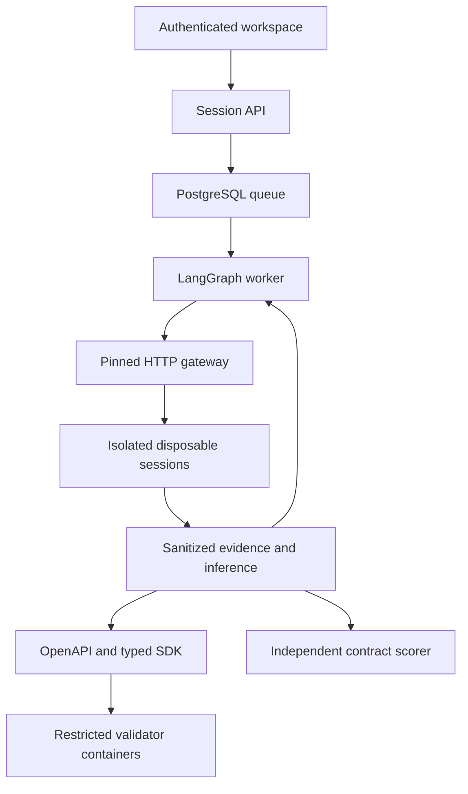

# Autonomous Black-Box API Discovery and SDK Generation

A completed local v0.1 research application for reconstructing authorized API behavior from controlled requests. It records hypotheses, sanitized observations, field evidence, and resource transitions, then generates an OpenAPI 3.1 document and a typed Python client.

The full local stack runs in Docker: authenticated Next.js workspace, FastAPI control plane, PostgreSQL queue, LangGraph worker, and four disposable targets. Python tests, PostgreSQL integration, browser workflows, container isolation, live HTTP benchmarks, and generated-client workflows have been executed locally. See [delivery status](docs/delivery-status.md) and [release checks](experiments/reports/release-checks.json) for the verification record.

## Run locally

Prerequisites: Docker Compose, Python 3.12 in Conda, Node.js 24+, and npm.

```bash
conda create -n api-discovery-ai python=3.12 -y
bash scripts/bootstrap.sh
conda run -n api-discovery-ai python -m scripts.setup_local
docker compose up --build -d
```

Open `http://127.0.0.1:3000`. Sign in with `WEB_USERNAME` and `WEB_PASSWORD` from the private, ignored `.env`. The setup command generates disposable credentials, never prints them, and never overwrites an existing configuration. Use `--api-port 18000 --web-port 13000` when the defaults are occupied.

Choose a target and budget, start discovery, inspect operations and evidence, browse resource transitions, and download the OpenAPI document, SDK, generated tests, validation status, and evidence report. Each dashboard session receives isolated fixture state. SDK validation stays an explicit operator action; the worker has no Docker socket and reports unexecuted checks as `not_run`.

## Implemented capabilities

- Exact-origin authorization, pinned DNS, redirect rejection, bounded requests, runtime credentials, structural response sanitization, and reserved control-path rejection.
- Affordance-based hypotheses, OPTIONS inspection, validation-error repair, controlled omissions and type perturbations, identifier reuse, dependency deferral, and bounded conflict/rate-limit retries.
- Recursive response inference with unions, evidence provenance, required-field verification, and resource transitions.
- FIFO, seeded random, and heuristic gain selection; an optional structured model can rank existing candidates within a persisted token reservation budget.
- Durable LangGraph checkpoints and a write-ahead attempt journal that prevents replay of uncertain mutations.
- OpenAPI 3.1 and typed Pydantic/HTTPX clients with wire aliases, status-only exceptions, cursor/limit options, and bounded same-collection pagination helpers.
- Restricted container SDK tests, lint, strict typing, packaging, and fresh-target live client workflows.
- Authenticated API, PostgreSQL queue and audit events, migrations, cancellation, session history, React Flow transitions, Recharts execution counts, and responsive workspace.
- Opt-in console export of sanitized OpenTelemetry stage traces and metrics.

## Architecture



The worker image excludes target source and ground truth. PostgreSQL stores queue and audit data; SQLite WAL stores detailed evidence, attempts, and graph checkpoints on the artifact volume. Only API and web join the ingress bridge. Worker and target networks remain internal. See [architecture](docs/architecture.md), [agent workflow](docs/agent-workflow.md), and [threat model](docs/threat-model.md).

## CLI and validation

```bash
# In another terminal, start a fresh disposable target.
conda run --no-capture-output -n api-discovery-ai python -m targets.service ecommerce --port 9101
conda run -n api-discovery-ai python -m scripts.discover \
  --config experiments/configs/ecommerce.json --output .runtime/run

docker build -f infrastructure/docker/validator.Dockerfile -t api-discovery-validator:local .
conda run -n api-discovery-ai python -m scripts.test_sandbox .runtime/run/sdk
```

Use `--runner core` for transport diagnostics. Use the original `--session` and directory to resume. Unknown request outcomes require operator reconciliation; uncertain mutations are never replayed automatically.

Run the complete local release gate:

```bash
conda run --no-capture-output -n api-discovery-ai python -m scripts.verify
```

Verification also requires Git, Gitleaks, and OpenSSL. This builds the stack, exposes the disposable verification database on loopback port 15432, runs Python/database/isolation and browser tests, builds the frontend, validates all 12 fixture SDKs, exercises live SDK workflows, runs 12 real HTTP benchmarks, and executes security and dependency checks. It leaves the stack running. The report is written to `experiments/reports/release-checks.json`; runtime logs remain ignored under `.runtime/verification`. Use `--database-port` if 15432 is occupied.

## Measured results

Gain-strategy HTTP results, with a fresh target process and a 100-request limit:

| Target | Correct operations | Requests | Transition coverage |
| --- | ---: | ---: | ---: |
| E-commerce | 32 / 32 | 66 | 100% |
| Subscriptions | 24 / 24 | 47 | 100% |
| Warehouse | 32 / 32 | 71 | 100% |
| Complex | 9 / 15 | 19 | 0% |

All reported operations match the independent contracts. Structural response-type accuracy is measured separately; it does not imply exact value or requiredness accuracy. Full results and scoring limits are in [evaluation](docs/evaluation.md) and [HTTP reports](experiments/reports/http/summary.json).

The complex fixture intentionally returns ambiguous nested configuration failures without usable repair evidence. The engine preserves the failure instead of inventing a contract. This is a measured research boundary. General hidden conditional-input synthesis, nonnumeric path parameters, arbitrary authentication inference, and exhaustive format/enum discovery are outside v0.1.

## Deployment boundaries

This is a single-operator local research application. Enterprise identity, tenant isolation, distributed artifact storage, arbitrary Internet target discovery, and a hosted model egress deployment are outside this release. No hosted model call or billing cost is claimed. The Docker worker has no Internet egress by default. No public repository or hosted service is created by local setup.

Python dependency snapshots and the npm lock file pin installed versions. Python snapshots do not include package hashes. API, target, validator, and web images have been built and exercised on Linux ARM64 through Docker Desktop. CI definitions are included; local verification does not establish that GitHub Actions has run.

[Desktop workspace capture](docs/images/workspace-desktop.png) · [Mobile workspace capture](docs/images/workspace-mobile.png)

## Project guide

[Deployment](docs/deployment.md) · [SDK generation](docs/sdk-generation.md) · [Security](docs/security.md) · [Delivery record](docs/delivery-status.md)

`apps/api` contains the API, worker, and migrations; `apps/web` the workspace; `packages/discovery` the discovery engine; `targets` the disposable services and independent contracts; `tests` the verification suites; `scripts` reproducible commands; `experiments/reports` measured results; and `infrastructure/docker` runtime images.
