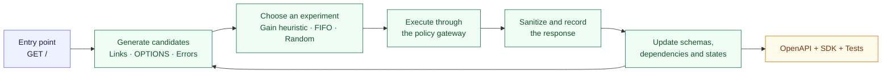
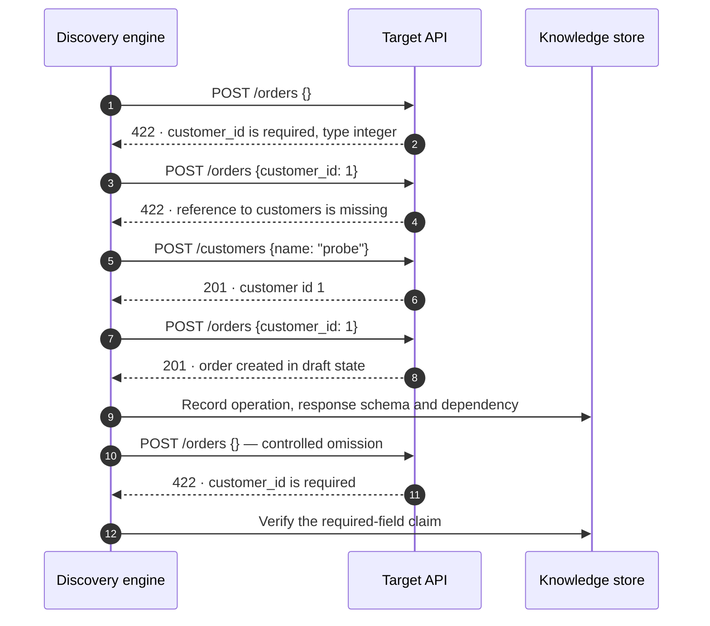
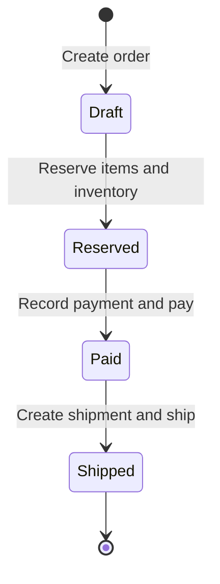
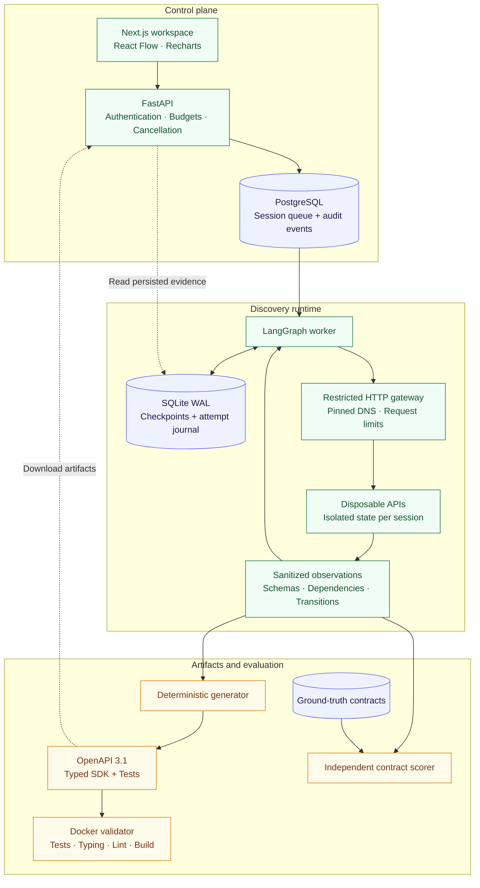
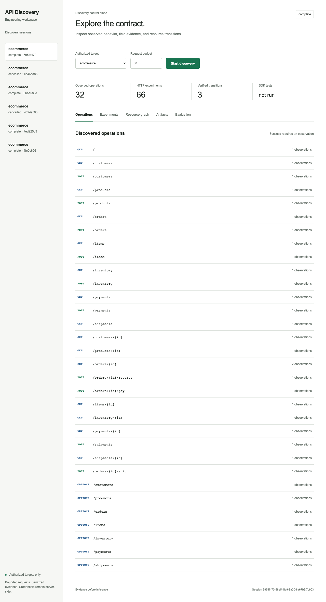
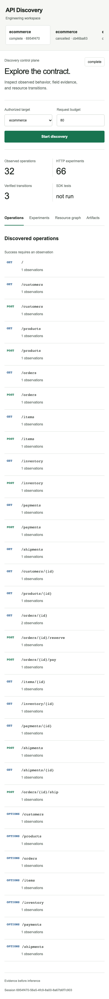

<div align="center">

# Autonomous API Discovery

### Turn HTTP behavior into an API contract and a typed SDK.

Discover endpoints, learn request schemas, map resource lifecycles, and generate a Python client through controlled black-box experiments.

[](pyproject.toml)
[](apps/web/package.json)
[](packages/discovery/graph.py)
[](docs/sdk-generation.md)
[](docker-compose.yml)
[](LICENSE)

[How it works](#how-it-works) · [Architecture](#architecture) · [Benchmarks](#benchmarks) · [Quick start](#quick-start) · [Documentation](#documentation)

</div>

---

## Overview

An undocumented API exposes more than endpoints. Validation errors reveal required fields, resource identifiers reveal dependencies, and successful mutations reveal state transitions. This project turns those signals into an executable contract.

The engine starts from an entry point, follows advertised links, and chooses experiments within a request budget. It learns which requests succeed, tests the assumptions behind them, and produces an **OpenAPI 3.1 specification**, a **typed Python SDK**, and **tests built from observed behavior**. A web workspace makes the discovery process inspectable: every operation, field claim, and transition links back to its evidence.

The system combines a deterministic discovery engine with durable LangGraph orchestration. An optional structured-output model can rank candidate experiments; destination policies and execution permissions are enforced independently.

## What it does

| Capability | How it works |
| --- | --- |
| **Endpoint discovery** | Follows response affordances and inspects advertised HTTP methods through OPTIONS requests. |
| **Request reconstruction** | Repairs structured validation failures, reuses observed identifiers, and defers requests until their dependencies exist. |
| **Field verification** | Removes one field or perturbs its type to distinguish successful examples from verified constraints. |
| **Response inference** | Merges nested objects, arrays, missing properties, and conflicting types into JSON Schema. |
| **Lifecycle mapping** | Compares observations of the same resource before and after mutations to recover state transitions. |
| **SDK generation** | Emits Pydantic models, HTTPX methods, wire-field aliases, pagination helpers, and observed-response tests. |
| **Durable execution** | Persists graph checkpoints and request intent so a restart cannot silently repeat an uncertain mutation. |
| **Interactive exploration** | Displays session history, experiment timelines, schemas, resource graphs, execution charts, and downloadable artifacts. |

## How it works

Discovery is an experiment loop. Each response changes what the engine knows and which request it should try next.



### Learning a request contract

A successful request supplies a candidate schema. A controlled failure provides evidence for a constraint.



The same approach extends to business workflows. For example, the commerce fixture requires order items and inventory before reservation, payment before the paid state, and a shipment before shipping.



## Architecture



### Engineering decisions

- **Keep network authority outside the model.** The gateway enforces the configured origin, DNS pins, method permissions, redirects, and request limits. The model can select an existing candidate index.
- **Journal requests before sending them.** A graph checkpoint cannot make an HTTP mutation transactional. A separate write-ahead journal records intent and stops automatic replay when the outcome is unknown.
- **Separate discovery from ground truth.** The worker image excludes fixture implementations and hidden contracts. The evaluator reads the contracts after exploration finishes.
- **Generate source deterministically.** Fixed templates turn observations into models and methods. Generated clients run in non-root, networkless containers with read-only mounts and bounded resources.
- **Give each session fresh fixture state.** Dashboard sessions use independent UUID namespaces, allowing repeated and concurrent discovery without resetting another session's resources.

## Benchmarks

The benchmark runs **four disposable APIs × three selection strategies** over real loopback HTTP. Every run starts a fresh target process, uses a 100-request budget, and scores the discovered contract against independently supplied ground truth.

### Gain-strategy results

| Target | Operations discovered | Endpoint precision | Endpoint recall | Transition coverage | HTTP requests |
| --- | ---: | ---: | ---: | ---: | ---: |
| E-commerce | **32 / 32** | 100% | **100%** | **100%** | 66 |
| Subscriptions | **24 / 24** | 100% | **100%** | **100%** | 47 |
| Warehouse | **32 / 32** | 100% | **100%** | **100%** | 71 |
| Complex / versioned | 9 / 15 | 100% | 60% | 0% | 19 |

**88 of 88 operations** and all expected transitions were recovered across the three business-workflow fixtures in **184 requests**. Endpoint precision was **100% across all 12 runs**.

The complex fixture combines versioned routes, nested inputs, cursor links, periodic rate limiting, and ambiguous configuration errors. Its missing job operations expose the current limit of repair from structured validation evidence: an error without actionable field information does not provide enough information to construct the hidden configuration.

### Strategy comparison

Each cell shows **correct operations / HTTP requests**.

| Target | FIFO | Seeded random | Gain heuristic |
| --- | ---: | ---: | ---: |
| E-commerce | 32 / 66 | 29 / 82 | **32 / 66** |
| Subscriptions | 24 / 47 | 24 / 58 | **24 / 47** |
| Warehouse | 32 / 71 | 32 / 78 | **32 / 71** |
| Complex / versioned | 9 / 19 | 9 / 20 | **9 / 19** |

Gain and FIFO reached the same results on these fixtures. The seeded random schedule required more requests and missed three commerce operations. The benchmark uses deterministic selection without hosted model calls.

Structural response-type accuracy is **87.7%**, **88.2%**, **87.6%**, and **78.7%** respectively. This metric compares nested type claims on discovered operations and excludes response values and field requiredness. Empty collections can leave array-item types unknown.

[Full HTTP results](experiments/reports/http/summary.json) · [Scoring methodology](docs/evaluation.md) · [In-process diagnostics](experiments/reports/fixture-diagnostics/summary.json)

### Generated-client execution

The 12 HTTP benchmark SDK bundles passed **746 container tests**, along with strict Mypy, Ruff, and package builds. A separate live workflow suite exercises all four gain-strategy clients against fresh target subprocesses inside networkless containers, covering creation, reads, multi-page traversal, status errors, and supported resource lifecycles.

The application suite contains **67 passing Python tests** plus **22 passing subtests**, including PostgreSQL integration, durable graph resume, policy boundaries, real HTTP/TLS transport, and container isolation. Playwright exercises the authenticated workspace and cross-origin write rejection.

## Workspace

Start a session, watch the experiment timeline, open an operation's field evidence, and inspect the graph of observed state transitions. Download the resulting contract and SDK from the same workspace.

<details>
<summary><strong>Desktop workspace</strong></summary>



</details>

<details>
<summary><strong>Mobile workspace</strong></summary>



</details>

## Quick start

**Requirements:** Docker Compose, Conda with Python 3.12, Node.js 24+, and npm.

```bash
git clone https://github.com/surtecha/autonomous-api-discovery.git
cd autonomous-api-discovery

conda create -n api-discovery-ai python=3.12 -y
bash scripts/bootstrap.sh
conda run -n api-discovery-ai python -m scripts.setup_local

docker compose up --build -d
```

Open **[localhost:3000](http://127.0.0.1:3000)** and sign in with `WEB_USERNAME` and `WEB_PASSWORD` from `.env`. Select a target, choose a request budget, and start discovery.

To use alternate ports, replace the setup command above with:

```bash
conda run -n api-discovery-ai python -m scripts.setup_local \
  --api-port 18000 --web-port 13000
```

The setup command creates private local credentials and preserves an existing `.env`. Each session produces:

```text
<session>/
├── knowledge.json       # Observations, schemas, field evidence and transitions
├── evidence.sqlite      # Write-ahead request journal
├── graph.sqlite         # Durable LangGraph checkpoints
├── sdk.zip              # Downloadable client bundle
└── sdk/
    ├── openapi.json     # Observed OpenAPI 3.1 contract
    ├── client.py        # Typed Pydantic models and HTTPX client
    ├── test_client.py   # Tests derived from observed responses
    ├── fixtures.json    # Sanitized request/response samples
    ├── pyproject.toml   # Installable client package
    └── validation.json  # Generation and container-check results
```

### Run discovery from the CLI

Start a disposable target in one terminal:

```bash
conda run --no-capture-output -n api-discovery-ai \
  python -m targets.service ecommerce --port 9101
```

Run the engine in another:

```bash
conda run -n api-discovery-ai python -m scripts.discover \
  --config experiments/configs/ecommerce.json \
  --output .runtime/run \
  --strategy gain
```

Choose `gain`, `fifo`, or `random` to compare experiment selection. `--runner core` runs the deterministic loop directly; the default runner uses LangGraph. Resume with the original `--session` and artifact directory.

### Validate an SDK

```bash
docker build -f infrastructure/docker/validator.Dockerfile \
  -t api-discovery-validator:local .

conda run -n api-discovery-ai python -m scripts.test_sandbox .runtime/run/sdk
```

The validator runs generated code inside restricted containers. The discovery worker has no Docker socket; artifact generation and executable SDK validation are separate stages.

## Reproduce the experiments

```bash
# Real HTTP discovery, independent scoring and SDK validation: all 12 runs.
conda run --no-capture-output -n api-discovery-ai \
  python -m scripts.benchmark --output experiments/reports/http

# Generate the in-process fixture bundles and exercise their clients over live HTTP.
conda run -n api-discovery-ai python -m scripts.fixture_diagnostics
conda run -n api-discovery-ai python -m scripts.live_sdk

# Run the full application, browser, container, benchmark and security suite.
conda run --no-capture-output -n api-discovery-ai python -m scripts.verify
```

Full verification additionally requires Git, Gitleaks, and OpenSSL. [Deployment](docs/deployment.md) covers configuration, ports, credentials, telemetry, and shutdown.

## Technology stack

| Layer | Technologies |
| --- | --- |
| Discovery and orchestration | Python 3.12, LangGraph, Pydantic, JSON Schema, optional OpenAI structured outputs |
| Control plane and persistence | FastAPI, SQLAlchemy, Alembic, PostgreSQL, SQLite WAL |
| Web workspace | Next.js, React, TypeScript, Tailwind CSS, TanStack Query, React Flow, Recharts |
| Generated clients | Pydantic v2, HTTPX, OpenAPI 3.1 |
| Testing and operations | Pytest, Hypothesis, Playwright, Ruff, Mypy, Docker Compose, OpenTelemetry, GitHub Actions |

## Project structure

```text
apps/
├── api/                 # Session API, queue worker and database migrations
└── web/                 # Discovery workspace and authenticated backend proxy
packages/discovery/      # Policy, transport, inference, graph, journal, generator and scorer
targets/                 # Disposable APIs and independent benchmark contracts
experiments/
├── configs/             # Authorized target policies
└── reports/             # Benchmark evidence, scores and generated SDK bundles
infrastructure/docker/   # Application, target and validator images
scripts/                 # Setup, discovery, evaluation and reproduction commands
tests/                   # Unit, property, integration, transport and container tests
docs/                    # Architecture, design decisions and operational guides
```

## Scope

The current inference grammar supports advertised relative paths with numeric resource identifiers, structured field errors, observable dependencies, and resource-state transitions. Hidden conditional inputs, arbitrary string identifiers, and general authentication inference are research extensions. String redaction also limits format and enum inference.

The deployment serves a single operator with PostgreSQL queueing and local evidence journals. Use the configured disposable targets for mutation experiments; external target policies allow read-only requests. The worker's Docker networks are internal by default.

## Documentation

[Architecture](docs/architecture.md) · [Discovery workflow](docs/agent-workflow.md) · [SDK generation](docs/sdk-generation.md) · [Evaluation](docs/evaluation.md) · [Deployment](docs/deployment.md) · [Security model](docs/threat-model.md) · [Design decisions](docs/decisions/001-boundaries.md)

## License

[MIT](LICENSE)
