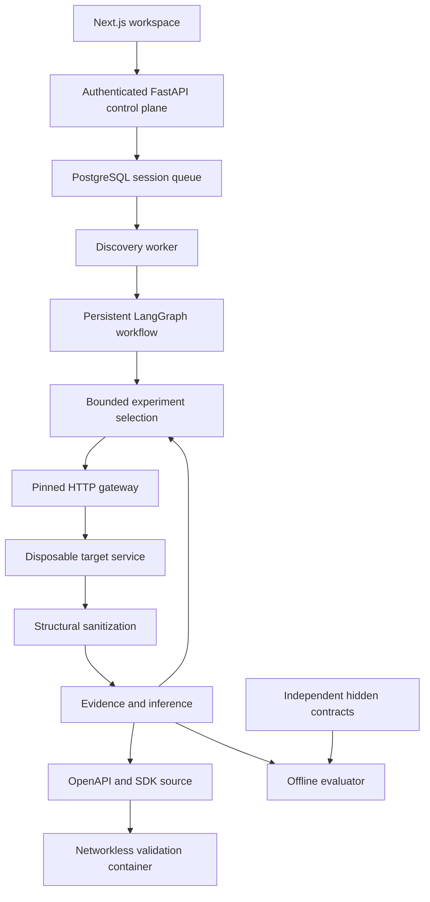

# Architecture

The control plane accepts an administrator-configured target identifier and a bounded request budget. Target origins, pinned IP addresses, mutation permission, and authorization text cannot be supplied through session creation.

## Execution boundaries

The worker image contains discovery packages and configuration, but no target implementation or ground-truth contracts. Target containers contain fixture implementations only. Ground truth is read by the scoring command after discovery completes. The in-process fixture diagnostic command deliberately does not provide this isolation and is not a black-box benchmark.

PostgreSQL persists session jobs, outcomes, and audit events. A SQLite WAL journal on the artifact volume persists sanitized experiment evidence and write-ahead attempt records. LangGraph maintains a separate SQLite checkpoint database. This hybrid is a documented deviation from storing every domain entity in PostgreSQL. The v0.1 deployment intentionally uses a single worker and shared local artifact volume. PostgreSQL normalization of the full evidence graph and distributed storage are separate research extensions.

## Failure semantics

An attempt is journaled before network execution. A completed observation is cached and can be returned after a graph replay without repeating the HTTP request. An interrupted attempt with no recorded outcome is rejected on resume. An uncertain state-changing request is never automatically replayed.

The session start time and attempt count persist across restarts. Failed network requests consume budget. The gateway revalidates policy before every request. The API can mark a session cancelled in the journal, including before worker initialization.

A worker job receives a 12-minute lease. Expired jobs become `interrupted`. They are not automatically returned to the queue. The CLI can resume a graph with its original session identifier and artifact directory. Reconciliation or a new disposable target is required for uncertain writes.

## Inference

Operations enter the confirmed set only after a successful HTTP response. An operation key is the exact method plus canonical path. Numeric identifier segments become `{id}`. Version prefixes are preserved.

Request fields begin as uncertain. A successful request followed by a controlled omission and a matching required-field error supports a required claim. A successful omission supports an optional claim. A controlled incompatible type followed by a matching type error supplies separate type evidence.

Response schemas merge observed values recursively. Missing fields are removed from the intersection of required properties. Conflicting types become unions. Empty arrays remain unknown. Response required sets describe observations, not proof that every response contains those fields.

State transitions require observations of the same resource identity before and after an operation. Failed mutations can trigger a resource read. Dependency failures record the referenced resource and receive confirmation only after a corresponding request succeeds.

## Known boundaries

Arbitrary nonnumeric path parameters, general nested request synthesis, conditional requirements, exhaustive enums, temporal formats, and generic authentication inference are not implemented. The complex fixture exposes these gaps. No module attempts to fill them with invented contract entries.

## Fixture session isolation

Administrator policies can enable `fixture_sessions` only for disposable targets. The gateway attaches the validated session UUID as `X-Discovery-Session`. Each target keeps independent bounded state per UUID, so repeated dashboard runs begin from an empty fixture without an operator reset. The public control plane cannot choose target origins or override these headers. This isolates test fixtures within the single-operator deployment; it does not implement tenant identity.
